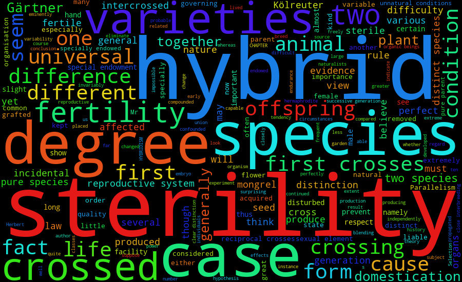
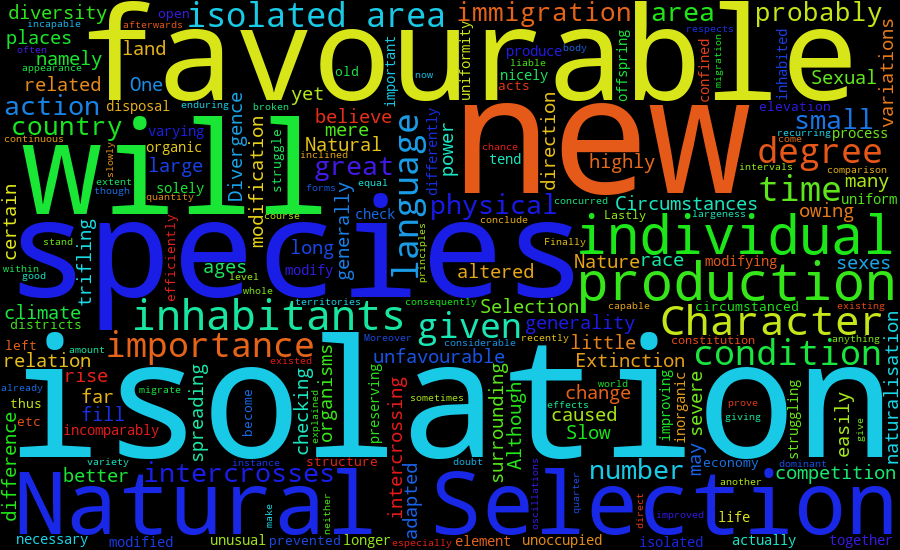

# Assignment 1: Unix and Python

## 1. Number of Subjects

### A. Download

git clone https://github.com/rmarquezp/IntroBiolComp-2026.git
cd IntroBiolComp-2026/Assignment1

`git clone` download the whole course repository.

### B. Individuals 8 and 22

cut -f 1 Gesquiere2011_data.csv | grep -w -c 8
cut -f 1 Gesquiere2011_data.csv | grep -w -c 22

`Cut -f 1` extract the maleID column, | pass this column to grep -w -c to count the number of rows in ID 8 or 22.

The first line outputs 17, and the second line outputs 5.

### C. Write a script

import sys（Import the sys module so that the program can read the parameters provided in the command line.）

file_name = sys.argv[1]（Get the first parameter in the command line）
individual_id = sys.argv[2]（Get the second parameter）
sample_count = 0

with open(file_name, "r") as data_file:
    for line in data_file:（Read files line by line）
        columns = line.split("\t")(Separate columns by tab)
        if columns[0] == individual_id:(Check whether the individual ID in the first column is the same as the ID entered in the command line.)
            sample_count = sample_count + 1(Add 1 to the count when matching.)

print(sample_count)(Output the number of times this individual has been sampled.)

python count_samples.py Unix/DataFiles/Gesquiere2011_data.csv 8
python count_samples.py Unix/DataFiles/Gesquiere2011_data.csv 22

Therefore, individual 8 was sampled 17 times and individual 22 was sampled 5 times.

### D. `Num_samples.csv`

import sys（Import the sys module so that the program can read the parameters provided in the command line.）

file_name = sys.argv[1]
sample_counts = {}（Create an empty dictionaryto save the number of samples of each ID.）

with open(file_name, "r") as data_file:
    for line in data_file:
        columns = line.split("\t")
        individual_id = columns[0]（Take out the first column of the current row.）
        
        if individual_id in sample_counts:（Check whether this ID is already in the dictionary.）
            sample_counts[individual_id] = sample_counts[individual_id] + 1（If this ID is already in the dictionary, add 1 to its sampling number.）
        else:
            sample_counts[individual_id] = 1（If this is the first time to encounter this ID, set its sampling to 1.）

output_file = open("Num_samples.csv", "w")（Open or create "Num_samples.csv"in write mode.）
output_file.write("maleID,Num_samples\n")（\n means to change to the next line.）

for individual_id in sorted(sample_counts, key=int):（Arrange the IDs in the dictionary by number size. Key=int means put "2" in front of "10".）
    output_file.write(individual_id + "," + str(sample_counts[individual_id]) + "\n")（Write the current ID, comma and its sampling number in one line. str() converts the number of times into text）

Python all_samples.py Unix/DataFiles/Gesquiere2011_data.csv

maleID,Num_samples
1,10
2,2
3,61
4,46
5,28
6,7
7,5
8,17
9,4
10,21

I'm not sure whether I wrote this question correctly, because my results are different from the sample results.

## 2. Mining The Origin of Species

### A. download a text version of The Origin

curl -o Origin.txt https://www.gutenberg.org/cache/epub/1228/pg1228.txt

### B. Count the number of keywords.

grep -i -w "sterility" Origin.txt
grep -i -w "isolation" Origin.txt
（-I ignores case, -w matches the whole word）
sterility: 97
isolation: 12

### C. Save the keyword context

grep -A 3 -B 3 'sterility' Origin.txt > sterility_context.txt
grep -A 3 -B 3 'isolation' Origin.txt > isolation_context.txt

`-A 3` and `-B 3` display the three lines before and after the matching line respectively. `>` writes the result to the corresponding text file.

### D. Word clouds

wordcloud_cli --text sterility_context.txt --imagefile sterility_wordcloud.png
wordcloud_cli --text isolation_context.txt --imagefile isolation_wordcloud.png

Use wordcloud_cli to read mytext.txt and generate a word cloud picture named wordcloud.png. --text is followed by the input text file, and --imagefile is followed by the output picture name.

### E. 

I disagree with the statement that "Darwin did not discuss the process of new species formation". The more prominent words in the isolation word cloud include species, new, forms, Natural Selection and production. Darwin discussed how isolation reduces intercrossing and how it affects the accumulation of differences between different groups. The more prominent words in the sterility word cloud include species, crosses, hybrids and fertility, indicating that he also discussed the hybridization of different species and hybrid infertility. Therefore, the word cloud and its context show that Darwin did discuss the process related to the formation of new species.

## 3. Twelve Days of Christmas

days = ["First", "Second", "Third", "Fourth", "Fifth", "Sixth", "Seventh", "Eighth", "Ninth", "Tenth", "Eleventh", "Twelfth"]

gifts = ["A Partridge in a Pear Tree",
         "Two Turtle Doves, and",
         "Three French Hens",
         "Four Colly Birds",
         "Five Gold Rings",
         "Six Geese-a-Laying",
         "Seven Swans-a-Swimming",
         "Eight Maids-a-Milking",
         "Nine Ladies Dancing",
         "Ten Lords-a-Leaping",
         "Eleven Pipers Piping",
         "Twelve Drummers Drumming"]
         
The first list saves English ordinal numbers for 12 days. The second list saves 12 gifts in the order in which the gifts are added to the song.
    for day_number in range(12):（The outer layer cycles 12 times）
    print("On the " + days[day_number] + " day of Christmas my true love gave to me:")（Use day_number to remove the name of the day from the days list and print the lyrics title of the day.）
    
    for gift_number in range(day_number, -1, -1):
        print(gifts[gift_number])（Print the gifts currently taken in the inner loop.）
    if day_number < 11:（Check whether it's not the last day yet.）
        print()（If it's not the last day, print an empty line and separate the lyrics of each day.）

On the First day of Christmas my true love gave to me:
A Partridge in a Pear Tree

On the Second day of Christmas my true love gave to me:
Two Turtle Doves, and
A Partridge in a Pear Tree

On the Third day of Christmas my true love gave to me:
Three French Hens
Two Turtle Doves, and
A Partridge in a Pear Tree

On the Fourth day of Christmas my true love gave to me:
Four Colly Birds
Three French Hens
Two Turtle Doves, and
A Partridge in a Pear Tree

On the Fifth day of Christmas my true love gave to me:
Five Gold Rings
Four Colly Birds
Three French Hens
Two Turtle Doves, and
A Partridge in a Pear Tree

On the Sixth day of Christmas my true love gave to me:
Six Geese-a-Laying
Five Gold Rings
Four Colly Birds
Three French Hens
Two Turtle Doves, and
A Partridge in a Pear Tree

On the Seventh day of Christmas my true love gave to me:
Seven Swans-a-Swimming
Six Geese-a-Laying
Five Gold Rings
Four Colly Birds
Three French Hens
Two Turtle Doves, and
A Partridge in a Pear Tree

On the Eighth day of Christmas my true love gave to me:
Eight Maids-a-Milking
Seven Swans-a-Swimming
Six Geese-a-Laying
Five Gold Rings
Four Colly Birds
Three French Hens
Two Turtle Doves, and
A Partridge in a Pear Tree

On the Ninth day of Christmas my true love gave to me:
Nine Ladies Dancing
Eight Maids-a-Milking
Seven Swans-a-Swimming
Six Geese-a-Laying
Five Gold Rings
Four Colly Birds
Three French Hens
Two Turtle Doves, and
A Partridge in a Pear Tree

On the Tenth day of Christmas my true love gave to me:
Ten Lords-a-Leaping
Nine Ladies Dancing
Eight Maids-a-Milking
Seven Swans-a-Swimming
Six Geese-a-Laying
Five Gold Rings
Four Colly Birds
Three French Hens
Two Turtle Doves, and
A Partridge in a Pear Tree

On the Eleventh day of Christmas my true love gave to me:
Eleven Pipers Piping
Ten Lords-a-Leaping
Nine Ladies Dancing
Eight Maids-a-Milking
Seven Swans-a-Swimming
Six Geese-a-Laying
Five Gold Rings
Four Colly Birds
Three French Hens
Two Turtle Doves, and
A Partridge in a Pear Tree

